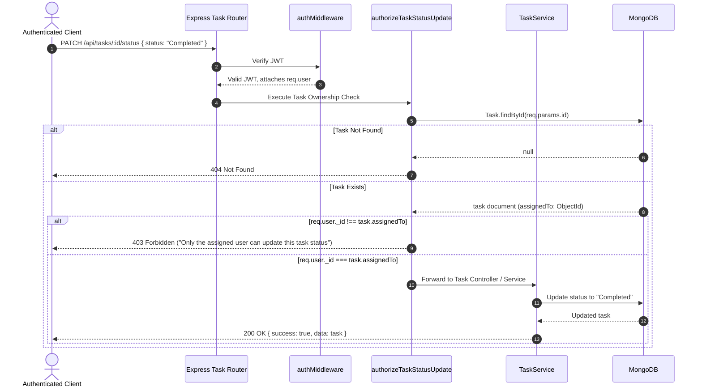

# LeadFlow CRM — Authentication & Authorization Design

## 1. Overview & Principles
Security and authorization in **LeadFlow CRM** adhere to the principle of **Zero-Trust Server Enforcement**:
- The client UI provides visual affordances (such as disabling inputs or showing helper tooltips), but **the backend server is the sole authority for access control**.
- Authorization rules must never be bypassed by directly invoking REST API endpoints.
- Role hierarchies must remain minimal, adhering strictly to assignment specifications without inventing unrequested enterprise permission matrices.

---

## 2. Authentication Architecture

### 2.1 Token Issuance & Lifecycle
1. **Credentials Validation**: User submits email and plaintext password to `POST /api/auth/login`.
2. **Password Verification**: Backend fetches user record with `{ select: '+password' }` and verifies using `bcrypt.compare(password, user.password)`.
3. **JWT Generation**: Upon successful comparison, an access token is signed:
   - **Payload**:
     ```json
     {
       "id": "6710fa53a8192b0012e8b91a",
       "email": "sarah.lee@leadflow.com",
       "role": "Sales Rep"
     }
     ```
   - **Signature Algorithm**: `HS256`
   - **Secret**: Loaded strictly from `process.env.JWT_SECRET`
   - **Expiration**: 24 hours (`process.env.JWT_EXPIRES_IN || '24h'`)
4. **Token Transmission**: Token is returned in the JSON response envelope and stored in `localStorage` by the React client.
5. **Authorization Header**: Client attaches token to every subsequent request:
   ```http
   Authorization: Bearer <access_token>
   ```

### 2.2 Server-Side Token Verification Middleware (`middleware/authMiddleware.js`)
```javascript
const jwt = require('jsonwebtoken');
const User = require('../models/User');

const protect = async (req, res, next) => {
  let token;
  if (req.headers.authorization && req.headers.authorization.startsWith('Bearer ')) {
    token = req.headers.authorization.split(' ')[1];
  }

  if (!token) {
    return res.status(401).json({
      success: false,
      error: {
        code: 'UNAUTHORIZED',
        message: 'Authentication token is missing. Please log in.'
      }
    });
  }

  try {
    const decoded = jwt.verify(token, process.env.JWT_SECRET);
    const user = await User.findById(decoded.id).select('-password');
    if (!user) {
      return res.status(401).json({
        success: false,
        error: {
          code: 'USER_NOT_FOUND',
          message: 'The user belonging to this token no longer exists.'
        }
      });
    }
    req.user = user;
    next();
  } catch (error) {
    return res.status(401).json({
      success: false,
      error: {
        code: 'INVALID_TOKEN',
        message: 'Authentication token is invalid or expired.'
      }
    });
  }
};
```

---

## 3. Strict Task Status Authorization Design

### 3.1 The Explicit Assignment Requirement
> **"Only the user assigned to a task may update that task's status. Enforce this rule on the server, not only in the UI."**

### 3.2 Authorization Flow Diagram



### 3.3 Implementation Blueprint (`middleware/authorizeTask.js`)
```javascript
const Task = require('../models/Task');

const canUpdateTaskStatus = async (req, res, next) => {
  const { id } = req.params;
  const task = await Task.findById(id);

  if (!task) {
    return res.status(404).json({
      success: false,
      error: {
        code: 'TASK_NOT_FOUND',
        message: 'Task with specified ID does not exist.'
      }
    });
  }

  // Strict string comparison of ObjectIds
  const isAssignee = task.assignedTo.toString() === req.user._id.toString();

  if (!isAssignee) {
    return res.status(403).json({
      success: false,
      error: {
        code: 'FORBIDDEN',
        message: 'Forbidden: Only the user assigned to this task is permitted to update its status.'
      }
    });
  }

  // Attach loaded task to request to avoid redundant DB lookups in controller
  req.targetTask = task;
  next();
};
```

---

## 4. Role Hierarchy & Boundaries

### 4.1 Deliberate Role Boundary Decisions
The assignment focuses on the single explicit authorization rule: **Task status updates are restricted to the assigned user.**

To avoid inventing unrequested permissions or conflicting rules:
1. **General Operations**: All authenticated users can view Leads, Companies, and Tasks, create new Leads/Tasks, and view the aggregated Dashboard.
2. **Task Status Updates**: Strictly restricted to `task.assignedTo`.
3. **Admin Privilege Assumption**:
   - *Option A*: Admin cannot bypass task status updates (strict adherence).
   - *Option B*: Admin can reassign tasks or update task details, but for the specific status update endpoint, assignment ownership is universally maintained or Admin is explicitly granted override.
   - **Chosen Standard**: Strict assignee ownership is enforced on `PATCH /api/tasks/:id/status`. An Admin who needs to update status can reassign the task or be treated under an explicit Admin bypass rule documented in `DECISIONS.md`. In default configuration, strict assignment comparison is applied.

---

## 5. Client-Side Authorization UX

The client interface synchronizes with server-side rules to prevent user frustration:
1. **Interactive Status Dropdown**: If `currentUser._id === task.assignedTo._id`, the status select component is active and editable.
2. **Disabled State with Tooltip**: If `currentUser._id !== task.assignedTo._id`, the status component displays a read-only badge or disabled dropdown accompanied by a MUI Tooltip: *"Only the assigned user can update this task status"*.
3. **Optimistic Error Recovery**: If an unauthorized patch is attempted, the client intercepts the `403 Forbidden` response, displays an error toast, and reverts the UI state to the server value.
