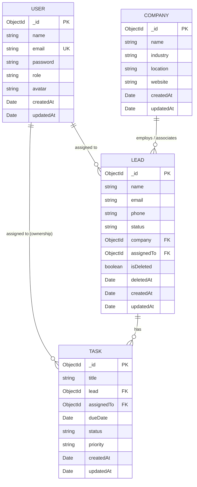

# LeadFlow CRM — Database Schema & Data Modeling Design

## 1. Overview
The **LeadFlow CRM** persistence tier uses **MongoDB** managed via the **Mongoose ODM**. The schema design prioritizes:
- Fast read access for search and dashboard aggregation pipelines.
- Absolute data integrity for soft-deleted records.
- Strict relational consistency between Leads, Companies, Users, and Tasks.

---

## 2. Entity Relationship Diagram (ERD)



---

## 3. Detailed Schema Specifications

### 3.1 User Schema (`models/User.js`)
Represents internal CRM agents, sales reps, and administrators.

```javascript
const userSchema = new mongoose.Schema(
  {
    name: {
      type: String,
      required: [true, 'User name is required'],
      trim: true,
      maxlength: [100, 'Name cannot exceed 100 characters']
    },
    email: {
      type: String,
      required: [true, 'Email is required'],
      unique: true,
      lowercase: true,
      trim: true,
      match: [/\S+@\S+\.\S+/, 'Please provide a valid email address']
    },
    password: {
      type: String,
      required: [true, 'Password is required'],
      minlength: [6, 'Password must be at least 6 characters'],
      select: false // Never return password hash in queries by default
    },
    role: {
      type: String,
      enum: ['Admin', 'Sales Rep', 'User'],
      default: 'Sales Rep'
    },
    avatar: {
      type: String,
      default: ''
    }
  },
  { timestamps: true }
);

// Indexes
userSchema.index({ email: 1 }, { unique: true });
```

---

### 3.2 Company Schema (`models/Company.js`)
Represents customer organizations and partner entities.

```javascript
const companySchema = new mongoose.Schema(
  {
    name: {
      type: String,
      required: [true, 'Company name is required'],
      trim: true,
      unique: true,
      maxlength: [120, 'Company name cannot exceed 120 characters']
    },
    industry: {
      type: String,
      trim: true,
      default: 'Technology'
    },
    location: {
      type: String,
      trim: true,
      default: ''
    },
    website: {
      type: String,
      trim: true,
      default: ''
    }
  },
  { timestamps: true }
);

// Indexes
companySchema.index({ name: 1 });
companySchema.index({ industry: 1 });
```

---

### 3.3 Lead Schema (`models/Lead.js`)
Represents prospective customers moving through the sales qualification funnel.

```javascript
const leadSchema = new mongoose.Schema(
  {
    name: {
      type: String,
      required: [true, 'Lead name is required'],
      trim: true,
      maxlength: [100, 'Name cannot exceed 100 characters']
    },
    email: {
      type: String,
      required: [true, 'Lead email is required'],
      trim: true,
      lowercase: true,
      match: [/\S+@\S+\.\S+/, 'Please provide a valid email address']
    },
    phone: {
      type: String,
      trim: true,
      default: ''
    },
    status: {
      type: String,
      required: [true, 'Lead status is required'],
      enum: {
        values: ['New', 'Contacted', 'Qualified', 'Lost', 'Converted'],
        message: '{VALUE} is not a valid lead status'
      },
      default: 'New'
    },
    company: {
      type: mongoose.Schema.Types.ObjectId,
      ref: 'Company',
      required: [true, 'Company reference is required']
    },
    assignedTo: {
      type: mongoose.Schema.Types.ObjectId,
      ref: 'User',
      default: null
    },
    isDeleted: {
      type: Boolean,
      default: false,
      index: true
    },
    deletedAt: {
      type: Date,
      default: null
    }
  },
  { timestamps: true }
);

// Compound & Performance Indexes
leadSchema.index({ isDeleted: 1, status: 1 });
leadSchema.index({ isDeleted: 1, company: 1 });
leadSchema.index({ isDeleted: 1, name: 'text', email: 'text' });
leadSchema.index({ createdAt: -1 });
```

---

### 3.4 Task Schema (`models/Task.js`)
Represents action items, calls, proposals, and demos linked to leads.

```javascript
const taskSchema = new mongoose.Schema(
  {
    title: {
      type: String,
      required: [true, 'Task title is required'],
      trim: true,
      maxlength: [200, 'Title cannot exceed 200 characters']
    },
    lead: {
      type: mongoose.Schema.Types.ObjectId,
      ref: 'Lead',
      required: [true, 'Associated lead is required']
    },
    assignedTo: {
      type: mongoose.Schema.Types.ObjectId,
      ref: 'User',
      required: [true, 'Assigned user is required']
    },
    dueDate: {
      type: Date,
      required: [true, 'Due date is required']
    },
    status: {
      type: String,
      enum: {
        values: ['Pending', 'In Progress', 'Completed'],
        message: '{VALUE} is not a valid task status'
      },
      default: 'Pending'
    },
    priority: {
      type: String,
      enum: ['High', 'Medium', 'Low'],
      default: 'Medium'
    }
  },
  { timestamps: true }
);

// Indexes
taskSchema.index({ assignedTo: 1, status: 1 });
taskSchema.index({ dueDate: 1 });
taskSchema.index({ lead: 1 });
```

---

## 4. Soft Deletion Implementation Pattern

Soft deletion is a strict requirement for Leads to guarantee historical record preservation without polluting active business views.

### 4.1 Safe Query Filtering Strategy
To eliminate human error and ensure consistency:
1. **Pre-Find Middleware**:
   ```javascript
   leadSchema.pre(/^find/, function (next) {
     // If explicit bypass is not requested, filter out deleted items
     if (!this.getFilter().includeDeleted) {
       this.where({ isDeleted: { $ne: true } });
     }
     next();
   });
   ```
2. **Explicit Service-Level Filters**:
   All aggregation pipelines and direct counts explicitly specify:
   ```javascript
   const activeFilter = { isDeleted: false };
   ```
3. **Associated Leads Protection**:
   When querying `Company.findById(id)` and retrieving associated leads:
   ```javascript
   const associatedLeads = await Lead.find({ company: companyId, isDeleted: false });
   ```

---

## 5. Aggregation Pipeline Design for Dashboard

The dashboard relies on database-level aggregation to deliver 100% computed metrics:

### 5.1 Pipeline: Lead Summary & Status Distribution
```javascript
const leadAggregation = await Lead.aggregate([
  { $match: { isDeleted: false } },
  {
    $facet: {
      totalLeads: [{ $count: "count" }],
      qualifiedLeads: [
        { $match: { status: "Qualified" } },
        { $count: "count" }
      ],
      statusBreakdown: [
        {
          $group: {
            _id: "$status",
            count: { $sum: 1 }
          }
        }
      ]
    }
  }
]);
```

### 5.2 Pipeline: Task Due Today & Completed Tasks
```javascript
const startOfDay = new Date();
startOfDay.setUTCHours(0, 0, 0, 0);

const endOfDay = new Date();
endOfDay.setUTCHours(23, 59, 59, 999);

const taskAggregation = await Task.aggregate([
  {
    $facet: {
      tasksDueToday: [
        {
          $match: {
            dueDate: { $gte: startOfDay, $lte: endOfDay }
          }
        },
        { $count: "count" }
      ],
      completedTasks: [
        { $match: { status: "Completed" } },
        { $count: "count" }
      ],
      upcomingTasks: [
        { $match: { status: { $ne: "Completed" } } },
        { $sort: { dueDate: 1 } },
        { $limit: 5 },
        {
          $lookup: {
            from: "leads",
            localField: "lead",
            foreignField: "_id",
            as: "leadInfo"
          }
        },
        { $unwind: { path: "$leadInfo", preserveNullAndEmptyArrays: true } }
      ]
    }
  }
]);
```

---

## 6. Seed Data Strategy
To support end-to-end evaluation and local demoing, a dedicated seed script (`server/src/scripts/seed.js`) will populate:
- **3 Users**:
  - `admin@leadflow.com` (Admin / Team Lead)
  - `sarah.lee@leadflow.com` (Sales Rep)
  - `mike.ross@leadflow.com` (Sales Rep)
- **5 Companies**: TechSol, Acme Corp, Globex, NextGen, ABC Corp.
- **20+ Leads**: Representing all statuses (`New`, `Contacted`, `Qualified`, `Lost`, `Converted`) and linked to companies and users.
- **10+ Tasks**: Linked to leads with varying due dates (Today, Tomorrow, Overdue) and statuses (`Pending`, `In Progress`, `Completed`).
